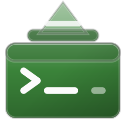

#+title: Heks BASH 💲
#+options: toc:nil
#+author: Josep Bigorra
#+email: jjbigorra@gmail.com

[[https://jointhefreeworld.org/ggg/dist/shell-bash.svg]] [[https://jointhefreeworld.org/ggg/dist/scheme-guile.svg]]  [[https://jointhefreeworld.org/ggg/dist/maak.svg]]  [[https://jointhefreeworld.org/ggg/dist/license-mit.svg]]  [[https://jointhefreeworld.org/ggg/dist/gnu-guix.svg]]

#+attr_html: :width 160 :alt Heks BASH logo

The all-mighty magical /Witch Bourne Again Shell declarative configuration/, supporting integration with many handy CLI tooling and handy aliases, customization, exports, and functions  using Lisp (Guile Scheme).

Modern Shell Experience ✨ with:
  - *One prompt everywhere:* the same two-line prompt, palette and git segment as my other machines ([[https://codeberg.org/jjba23/cask-and-cons][cask-and-cons]] on macOS, [[https://codeberg.org/jjba23/wolk-jjba][wolk-jjba]] on the server), with a per-machine sigil, accent and badge so you can tell at a glance where you are.
  - *Git at a glance:* branch, dirty/conflict counts, ahead/behind and stash count, from a single =git status --porcelain=v2 --branch= per prompt (≈4 ms, no plugins).
  - *Integrations:* Modular support for    *[[https://github.com/akinomyoga/ble.sh][ble.sh]]* (Bash Line   Editor), *[[https://github.com/junegunn/fzf][fzf]]* (Fuzzy Finder),    and *[[https://direnv.net/][direnv]]*.
  - *Intelligent Completion:* Case-insensitive, spelling correction    (=cdspell=, =dirspell=), and auto-cd.
  - *Dynamic funny and customizable greetings* (GNU, RMS, Emacs and Linux sayings, kept as Scheme data in =bash-greetings=) plus =about=, =hist-top= and =rc-time=.
  - *History Management:* Large history size, timestamped entries, and    duplicate deduplication.
  - *Guix & Nix Friendly:* Automatically handles paths for Guix profiles  and provides aliases for =nix develop=, plus ~[guix env]~, ~[nix]~ and ~[venv]~ badges in the prompt.
  - *Dev-Ready Aliases:* Includes shortcuts for =git=, =docker=, =podman=,  =emacs=, and file navigation, plus small helpers (=mkcd=, =extract=, =serve=, =psg=, =kport=, =notify=, =ports=, =bak=, =calc=, =json=, =paths=, =ff=, =reload=).

  Heks is also best friends, this heks-bash is best used with the [[https://codeberg.org/jjba23/heks-linux][Heks GNU/Linux system]] but should be compatible across a large range of systems out of the box and minimal dependencies.

The project is written mostly in Lisp  and Bash (shell script).

This project uses [[https://codeberg.org/jjba23/maak][Maak, the infinitely extensible command-runner]] as automation system.

This config uses [[https://github.com/akinomyoga/ble.sh][ble.sh]] and to install it you should check out the ~maak.scm~ file, or their GitHub.

If you like my work, please support me by [[https://bmc.link/jjbigorra][buying me a cup of coffee ☕]] so I can continue with a lot of motivation.

---------------

🐰 If you really want to go down the rabbit hole, then you  wanna use the Lisp code and programatically build the bashrc, then you need *GNU Guix and Guile* to compile the ~*.scm~ code to a Bash config. Optional Tools are:  =maak= , =fzf=, =direnv=, =fastfetch=, =nix=, =guix= =emacs=, =podman=.

The project uses [[https://www.gnu.org/software/guile/manual/html_node/Parameters.html][Guile Parameters]] for configuration, allowing you to dynamically and lexically work with the config customization.

As for the ~EDITOR~ variable, heks-bash uses a custom script to intelligently determine which kind of Emacs to run (GUI or CLI)

------------------

[[https://jointhefreeworld.org/static-assets/heks/screen-2026-07-15-23-05-24.png]]

--------------------------

Create a script (e.g., =install-env.scm=) or run in your REPL:

#+begin_src scheme
(use-modules (heks-bash bash))

;; Generates and writes configuration to ~/.bashrc
(install-bash)
#+end_src

-----------

*Key Parameters:*

- =bash-identity=: Alist of the =CC_*= variables that make the prompt say who this machine is (=CC_FLAVOR=, =CC_HOST_KIND=, =CC_SIGIL=, =CC_ACCENT=, =CC_RC_FILE=).
- =bash-aliases=: Association list of machine-specific aliases (the shared set lives in =shell-lib.bash=).
- =bash-functions=: Association list of machine-specific functions.
- =bash-vars=: Environment variables (colors, history settings).
- =heks-bash-clone-dir=: Location of the source repository.
- =shell-lib-filename=: Name of the shared shell library that is spliced into the generated =.bashrc= (default =shell-lib.bash=).
- =lesskey-filename=: Name of the shared pager keymap, installed as =$XDG_CONFIG_HOME/lesskey= (default =lesskey=).

** 🛠 Configuration Details

*** Default Aliases

The module comes with sensible defaults for navigation and development:

| Alias       | Command               | Description                              |
|-------------+-----------------------+------------------------------------------|
| =..=, =...= | =cd ..=, =cd ../..=   | Quick navigation up directories          |
| =ll=, =l=   | =ls -lAh ...=         | List all files with human-readable sizes |
| =tree=      | =tree --dirsfirst -F= | Tree view                                |
| =e=         | =emacsclient -t=      | Edit in Emacs terminal client            |
| =fetch=     | =fastfetch=           | System info fetch                        |
| =docker=    | =podman=              | Aliases Docker commands to Podman        |

*** Custom Functions

The shared library (=src/heks-bash/shell-lib.bash=, spliced verbatim into
=~/.bashrc=) provides, among others:

| Function      | What it does                                                     |
|---------------+------------------------------------------------------------------|
| =about=       | print the machine identity, shell/git versions and prompt legend |
| =pager-keys=  | the Emacs pager keymap, one screen                              |
| =hist-top=    | most used commands from the history file                         |
| =rc-time=     | average startup cost of the shell, over N runs                   |
| =hgrep=       | grep the command history                                         |
| =gunlog=      | decompress a =.gz= log and page through it                       |
| =mkcd=        | create a directory and cd into it                                |
| =up N=        | go up N directories                                              |
| =extract=     | unpack tar/tgz/txz/zst/zip/7z/rar/gz/bz2/xz in one verb           |
| =serve [port]=| throwaway HTTP server in the current directory                   |
| =psg=         | grep the process list without matching grep itself                |
| =kport=       | kill whatever listens on a TCP port                              |
| =ports=       | listening sockets (ss, or lsof where ss is absent)               |
| =notify=      | desktop notification with a TTY fallback                         |
| =bak=         | timestamped backup copy of a file                                |
| =calc=        | quick floating point maths via awk                               |
| =json=        | pretty-print JSON (python3 -m json.tool)                         |
| =paths=       | the PATH, one entry per line, numbered                           |
| =ff=          | find a file by name fragment                                     |
| =cdroot=      | jump to the root of the current git work tree                    |
| =reload=      | re-source the shell rc                                           |
| =gst= =gd= =gds= =glog= =gco= =gsw= =gbr= =gcm= =gpl= =gpu= =gfetch= | terse git shortcuts and a graph log |

Machine-specific extras (the =maak= aliases, =keys-show=, =tui-emacs=,
=haskell-dev=, =scala-dev=, ...) are declared in =bash-aliases= and
=bash-functions= in =bash.scm=.

*** The Prompt

The prompt is rebuilt on every command by =__cc_prompt= from the shared
library, and looks the same on every machine I run this config on:

#+begin_src shell
╭─ joe@framew0rk λ guix/linux …/Hacking/heks-bash [guix env]
╰─ main ✚2 ↑1↓3 ⚑1 λ
#+end_src

- *Line 1*: bold user@host, the machine badge (=λ guix/linux= here; =⌘ macos= on the Mac, =ω guix/server= on the server — sigil, badge and accent colour change per machine, the layout does not), the path trimmed to the last three components, and a badge for an active Guix shell, Nix shell or Python venv.
- *Line 2*: the git segment — branch (or =@sha= when detached), =✚n= changed files, =✖n= conflicts, =✓= clean, =↑n=/=↓n= ahead/behind, =⚑n= stashes — then the sigil as the actual prompt.
- =CC_PLAIN=1= (or =NO_COLOR=, or =TERM=dumb=) renders exactly the same prompt without colour.
- A random greeting is printed once per interactive startup; =about= explains the rest.

=git= is the only fork per prompt: the branch, upstream divergence and
dirty state all come from one =git status --porcelain=v2 --branch=.

*** The Pager

The pager is plain =less=, everywhere and with the same keys: =PAGER= and
=MANPAGER= are set to =less=, =LESS= is =-F -I -M -R= (quit if the output
fits on one screen, case-insensitive search, the long prompt, colour), and
=src/heks-bash/lesskey= gives it Emacs key bindings. =install-bash= copies
that file to =$XDG_CONFIG_HOME/lesskey=, which is the first place =less=
582 and later look; no =lesskey= compile step is involved, and older =less=
versions just keep their default keys.

| Key          | What it does                                   |
|--------------+------------------------------------------------|
| =C-n= =C-p=  | one line down / up                             |
| =C-f= =C-b=  | one screen down / up                           |
| =C-v= =M-v=  | one screen down / up                           |
| =C-d= =C-u=  | half a screen down / up                        |
| =C-a= =C-e=  | top / bottom of the file                       |
| =M-<= =M->=  | top / bottom of the file                       |
| =C-s= =C-r=  | search forward / backward                      |
| =M-g=        | go to line                                     |
| =M-u=        | clear the search highlighting                  |
| =C-l=        | redraw the screen                              |

Inside the =less= prompts (=:e=, =/=, =?=) the keys are Emacs keys too:
=C-a= / =C-e= beginning / end of the line, =C-b= / =C-f= and =M-b= / =M-f=
character and word motion, =C-w= / =M-d= kill word, =C-k= / =C-u= kill the
line, =C-g= cancel. Nothing was taken away: =space=, =b=, =j=, =k=, =g=,
=G=, =/=, =?=, =n=, =N=, =m=, ='=, =!=, =|= and =q= keep their less
meaning. =pager-keys= prints the map anywhere; =about= says where the file
lives.

=C-s= is also a working forward-search in readline because =cc_boot= runs
=stty -ixon= on interactive ttys (no more frozen terminal on =C-s=).

----------------

** Ble.sh

You can update  ble.sh with ~ble-update~

----------------------

* AI Policy

This project follows the [[https://jointhefreeworld.org/ai-policy/][jointhefreeworld AI policy]].
[[file:AI_POLICY.md][AI_POLICY.md]] holds the short version; the full policy is the link above.

--------

* Code of conduct

This project adheres to the jointhefreeworld code of conduct. Find it here:

https://jointhefreeworld.org/blog/articles/personal/jointhefreeworld-code-of-conduct/index.html

In summary, we foster an inclusive, respectful, and cooperative environment for all contributors and users of this free software project. Inspired by the ideals of the GNU Project, we strive to uphold freedom, equality, and community as guiding principles. We believe that collaboration in a community of mutual respect is essential to creating excellent free software.

-------

* On Reproducibility: Why GNU Guix?

A build should never fail because "it worked on my machine." Reliable software development requires explicit, bit-for-bit reproducibility and a functional approach to package management and system deployment.

#+BEGIN_EXPORT html

#+END_EXPORT

- *Declarative Build Graphs:* Packages are pure functions of their inputs with no implicit system state.
- *Programmable with Guile:* Full system and package configurations written in [[https://www.gnu.org/software/guile/][Guile Scheme]] rather than rigid DSLs or static files.
- *Time Travel:* Rebuild the exact system state from any point in git history using ~guix time-machine~.
- *Atomic Operations:* Instantly upgrade or roll back environments without leaving orphaned dependencies or broken states.
- *Unified Tooling:* One tool manages development shells, isolated containers, package builds, and full system configurations.

--------

* License

heks-bash is released under the [[file:LICENSE][MIT license]]. The full text is in
=LICENSE= at the root of the repository, and every source file carries the same
terms and an =SPDX-License-Identifier: MIT= tag in its header.
